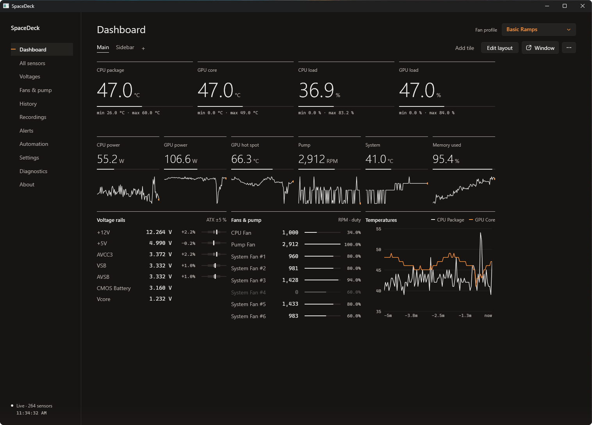
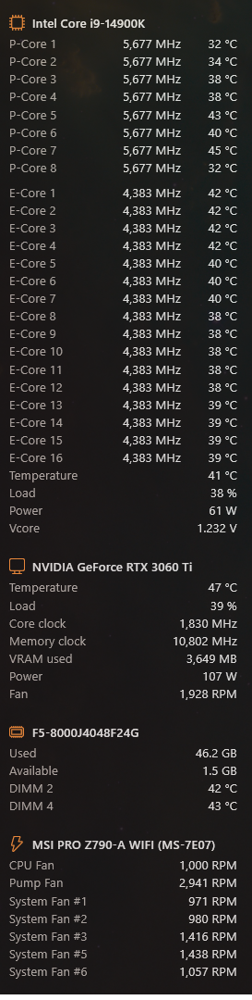
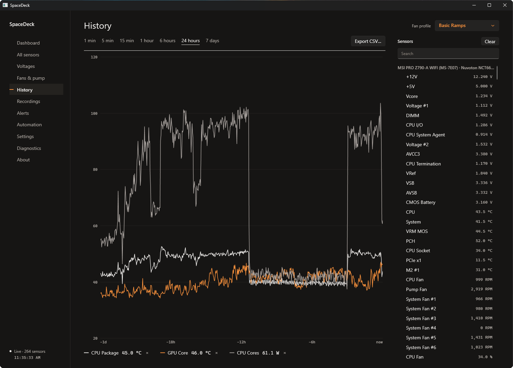

# SpaceDeck

**Hardware monitoring dashboards for Windows.** SpaceDeck shows your PC's temperatures, voltages, fans, clocks, loads
and power on dashboards you lay out yourself, with alerts, history and automatic
[FanControl](https://github.com/Rem0o/FanControl.Releases) profile switching. Sensors are read by the
LibreHardwareMonitor library, which is built in, on top of the signed PawnIO driver. The only thing to install besides
SpaceDeck is PawnIO; you don't need the LibreHardwareMonitor app or HWiNFO.



> **Status: early access (0.1).** Everything below works on the developer's own PC. Hardware support comes from
> LibreHardwareMonitor, so most desktops and laptops work, but less common boards may show generic sensor names that
> you can rename.

## Features

- **Dashboards you design:** a 12-column grid of tiles (big numbers, gauges, bars, sparklines, charts, voltage rails,
  fans, core maps, network and disk throughput, clocks). Several dashboards as tabs, or each in its own window or
  overlay.
- **Screen-edge sidebar:** dock a compact dashboard to the edge of any monitor, Sidebar Diagnostics style. It fits
  itself to the screen height and hides during fullscreen games.
- **All sensors in one place:** search, rename, hide or correct any sensor, and add calculated sensors (e.g. CPU + GPU power).
- **Alerts:** sensible limits out of the box, Windows notifications, sounds, quiet hours, and optional phone alerts via
  [ntfy](https://ntfy.sh).
- **History:** the background collector keeps 24 hours at full rate and 7 days per minute, even while the app is
  closed. CSV export and recording sessions with summaries are included.
- **Fan profiles and automation:** switch FanControl configs by hand (window, tray or phone) or with rules, such as
  "while a game runs" or "CPU above 80 °C for 30 s". SpaceDeck never writes to fans itself.
- **Phone and tablet dashboard:** view your dashboards live in a browser on your home network (phone, tablet, Steam
  Deck), paired with a PIN.
- **16 skins**, °C/°F, 12/24-hour clock, backup and restore, and no telemetry.

<p>
  
  &nbsp;
  
</p>

## Install

1. Install the **PawnIO** driver (official signed edition) from [pawnio.eu](https://pawnio.eu). SpaceDeck needs it to
   read sensors; it is never bundled.
2. Download `SpaceDeck-<version>-x64.msi` from [Releases](../../releases) and run it. It installs the app and the
   background collector service, and includes .NET, so nothing else is needed.
3. Open **SpaceDeck** from the Start menu. The first start opens **Diagnostics**, which checks each piece and offers a
   fix where it can.
4. *(Optional)* Install [FanControl](https://github.com/Rem0o/FanControl.Releases) and save one config per fan
   profile (File → Save as…). SpaceDeck finds it and lists the profiles.

**Requirements:** Windows 10 (2004 or later) or Windows 11, x64, on real hardware. Virtual machines expose few or no
sensors.

**Updating:** SpaceDeck can check for new versions (About → Updates, off by default). Installing a new MSI over the old
one keeps all settings and history. **Uninstalling** (Settings → Apps) removes the program and the service and keeps
your data in `%AppData%\SpaceDeck` and `%ProgramData%\SpaceDeck`.

### Good to know

- **Anti-cheat:** some anti-cheat systems (FACEIT, for example) refuse to run while the PawnIO driver is loaded. This
  affects every tool that uses PawnIO, including FanControl and LibreHardwareMonitor, and SpaceDeck can't work around
  it.
- **Not a safety device:** readings can be wrong and alerts can be late. Keep your BIOS fan and thermal protections on.
- The installer isn't code-signed yet, so Windows SmartScreen may ask you to confirm ("More info" → "Run anyway").

## How it works

```
PawnIO driver (installed separately)
      ▲
LibreHardwareMonitorLib  ── knows the chips and boards
      ▲
SpaceDeck Collector  (Windows service, LocalSystem)  ──named pipe──►  SpaceDeck app (normal user, no admin rights)
```

The collector is the only part that needs administrator rights. It reads sensors, keeps history and serves the app over
`\\.\pipe\SpaceDeck` ([protocol](docs/PROTOCOL.md)). The app is a normal WPF program. The optional network dashboard
is served by the app, on your local network only.

## Build from source

You need the [.NET 10 SDK](https://dotnet.microsoft.com/download/dotnet/10.0), and optionally Visual Studio 2026 (or
2022 17.14+) with the ".NET desktop development" workload.

```powershell
dotnet build SpaceDeck.slnx -c Release
dotnet test SpaceDeck.slnx -c Release
```

Run the pieces during development:

```powershell
# Collector in the foreground (elevated terminal), or install it as a service (elevated):
dotnet run --project src/SpaceDeck.Collector
powershell -NoProfile -ExecutionPolicy Bypass -File .\scripts\Install-Collector.ps1

# The app (normal terminal, with the collector running):
dotnet run --project src/SpaceDeck.App

# Command-line diagnostics:
dotnet run --project src/SpaceDeck.Cli -- list              # every sensor (elevated)
dotnet run --project src/SpaceDeck.Cli -- connect           # live data from the collector
dotnet run --project src/SpaceDeck.Cli -- fancontrol        # find FanControl and its configs
```

Release builds and the installer (Windows, needs nothing beyond the .NET SDK; WiX is restored from NuGet):

```powershell
powershell -NoProfile -ExecutionPolicy Bypass -File .\scripts\Build-Installer.ps1 -Version 0.1.0
# -> artifacts\installer\SpaceDeck-0.1.0-x64.msi and SHA256SUMS.txt
```

GitHub Actions builds, tests and packages every push. Raising `<Version>` in `Directory.Build.props` and pushing to
`main` publishes that version as a release (tag, MSI and `SHA256SUMS.txt`).

<details>
<summary>Repository layout</summary>

| Path | What |
|---|---|
| `src/SpaceDeck.Core` | Shared model, `ISensorSource`, pipe protocol, formatting |
| `src/SpaceDeck.Sources.Lhm` | LibreHardwareMonitor source, PawnIO and elevation checks |
| `src/SpaceDeck.Integrations.FanControl` | Finds FanControl, lists and switches its configs |
| `src/SpaceDeck.Collector` | Windows service: polls sensors, keeps history, serves the app |
| `src/SpaceDeck.App` | WPF app: dashboards, sidebar, sensors, history, alerts, automation, settings, network dashboard |
| `src/SpaceDeck.Cli` | `spacedeck-cli` diagnostics tool |
| `tests/` | xUnit tests (Core; collector history and pipe end-to-end) |
| `installer/` | WiX v5 MSI |
| `scripts/` | Release publish, installer build, development service install |
| `docs/` | Pipe protocol, test plan, LibreHardwareMonitor update routine |

</details>

## License and privacy

SpaceDeck is free software under the [MIT License](LICENSE). Third-party components and their licenses are listed in
[THIRD-PARTY-NOTICES.txt](THIRD-PARTY-NOTICES.txt): LibreHardwareMonitorLib and its helpers are MPL-2.0, the PawnIO
modules it embeds are LGPL-2.1, HidSharp is Apache-2.0, the rest are MIT. The PawnIO driver and FanControl are
separate projects, installed by you and never bundled or modified; SpaceDeck isn't affiliated with either.

No telemetry. The network dashboard, phone alerts and update check are opt-in; [PRIVACY.md](PRIVACY.md) says exactly
what each one sends.
